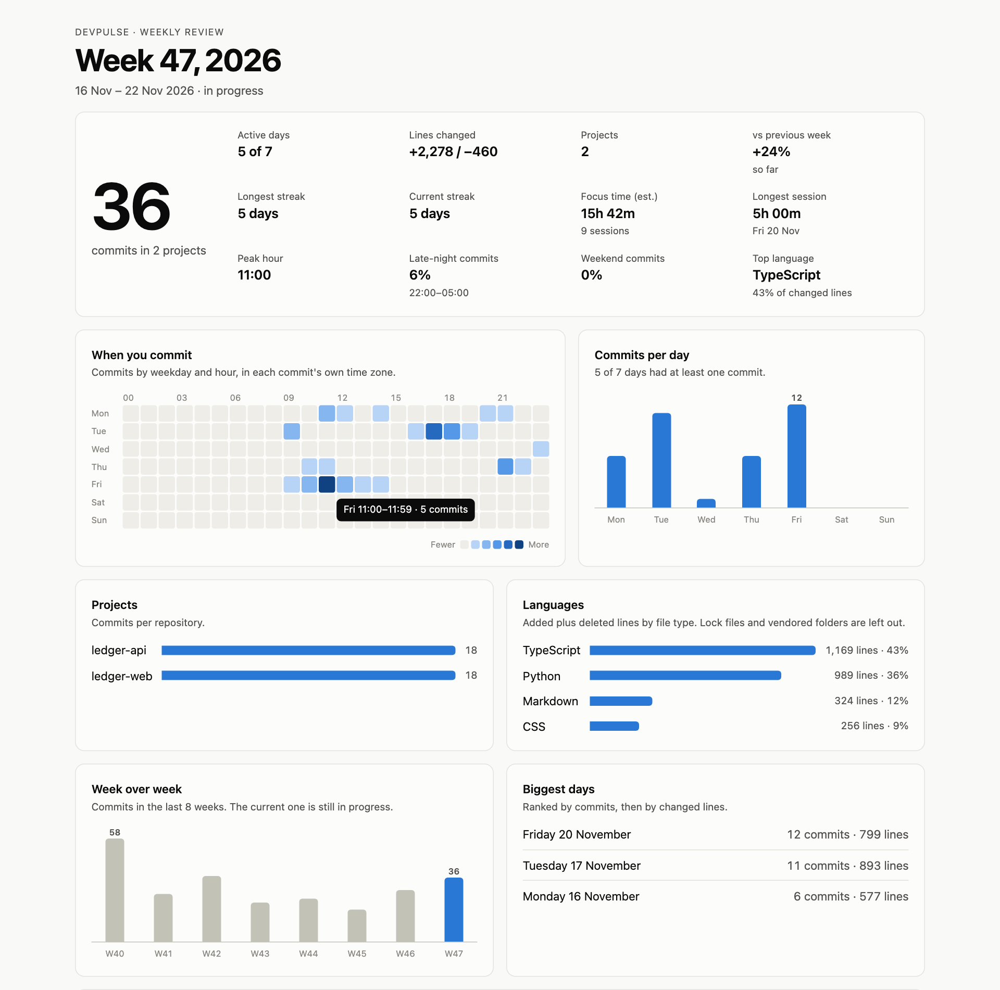
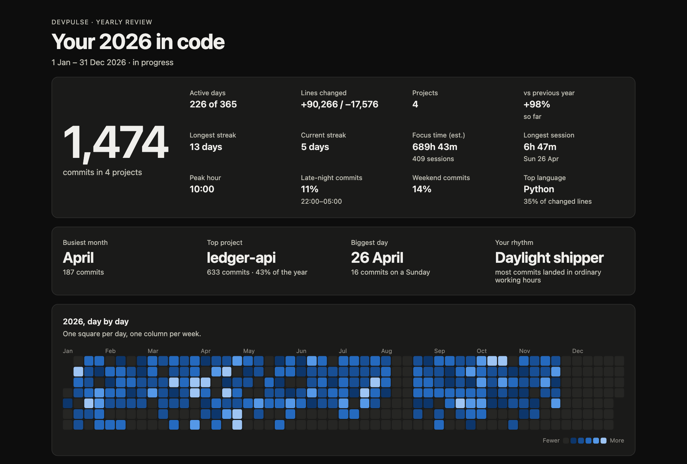

# devpulse

Your personal engineering weekly review, generated from the git history already on your disk.
Point it at the folder that holds your repos and get a terminal summary, a Markdown note for Obsidian and a self-contained HTML dashboard. Nothing is uploaded.



The screenshots show devpulse run on invented repositories made by [`scripts/demo_repos.py`](scripts/demo_repos.py).

## Quickstart

You need Python 3.10 or newer and `git`.

```sh
pipx install git+https://github.com/Habibeyilmazz/devpulse
devpulse week ~/code --open
```

Or run it once without installing:

```sh
uvx --from git+https://github.com/Habibeyilmazz/devpulse devpulse week ~/code --open
```

`~/code` is whatever folder contains your repositories. devpulse finds every repo below it and counts the commits made with each repo's configured `user.email`. There is no config file.

To try it without pointing it at real work:

```sh
git clone https://github.com/Habibeyilmazz/devpulse && cd devpulse
python3 scripts/demo_repos.py /tmp/devpulse-demo
devpulse year /tmp/devpulse-demo --open
```

## Commands

| Command | What you get |
| --- | --- |
| `devpulse week [PATH]` | This ISO week, Monday to Sunday |
| `devpulse month [PATH]` | This calendar month |
| `devpulse year [PATH]` | This calendar year as a wrapped-style recap: busiest month, top project, biggest day, your rhythm, and a day-by-day calendar |
| `devpulse standup [PATH]` | Bullets for your last active day and for today, ready to paste |

Options for `week`, `month` and `year`:

| Option | Effect |
| --- | --- |
| `--md PATH` | Write the Markdown note. `PATH` is a `.md` file or a folder, for example a folder in your Obsidian vault |
| `--html PATH` | Write the HTML dashboard to a `.html` file or a folder |
| `--open` | Open the dashboard in your browser (in a temp folder if `--html` is not given) |
| `--last` | Report on the previous week, month or year |
| `--ai` | Add a narrative summary written by Claude. See [AI summary](#ai-summary-optional) |

Options for every command:

| Option | Effect |
| --- | --- |
| `--author NAME_OR_EMAIL` | Count commits whose author contains this text instead of the repo's `user.email`. Repeat it if you commit under several identities |
| `--date YYYY-MM-DD` | Report on the period that contains this day instead of today |
| `--depth N` | How many folder levels below `PATH` to search for repos (default 3) |

Files are named after the period: `devpulse-2026-W47.md`, `devpulse-2026-11.html`, `devpulse-2026.html`.

### In the terminal

```
$ devpulse week ~/code

devpulse · weekly review · Week 47, 2026 (16 Nov – 22 Nov 2026)

Commits            36              Focus time (est.)    15h 42m (9 sessions)
Active days        5 of 7          Longest session      5h 00m (Fri 20 Nov)
Lines changed      +2,278 / −460   Biggest day          Fri 20 Nov (12 commits)
Projects           2               Peak hour            11:00
vs previous week   +24% (so far)   Late-night commits   6% (22:00–05:00)
Longest streak     5 days          Weekend commits      0%
Current streak     5 days          Top language         TypeScript (43% of changed lines)

Hours 00–23           ▃▃█▃▁▂ ▁▄▃▁▁▄▁▁
Per day      ▄▇▁▄█

Project     Commits          Lines  Latest
ledger-api       18  +1,076 / −237  Speed up invoice totals
ledger-web       18  +1,202 / −223  Document date picker

Languages by changed lines  TypeScript 43%, Python 36%, Markdown 12%, CSS 9%
```

```
$ devpulse standup ~/code
Yesterday (Thu 19 Nov)
  - ledger-api: Test webhook retries
  - ledger-api: Simplify webhook retries
  - ledger-web: Add empty states
  - ledger-web: Refactor empty states
  - ledger-web: Polish empty states
  - ledger-web: Test keyboard shortcuts

Today (Fri 20 Nov)
  - ledger-api: Speed up CSV export
  - ledger-api: Add CSV export
  ...
```

On a Monday, "Yesterday" becomes "Last active day" and shows Friday.

### As an Obsidian note

`devpulse week ~/code --md ~/vault/Reviews` writes `devpulse-2026-W47.md`:

```markdown
---
title: "What I shipped: Week 47, 2026"
type: "weekly-review"
period: "2026-W47"
start: "2026-11-16"
end: "2026-11-22"
commits: 36
active_days: 5
lines_added: 2278
lines_deleted: 460
focus_minutes: 942
projects: ["ledger-api", "ledger-web"]
tags: ["devpulse", "weekly-review"]
---

# What I shipped: Week 47, 2026

16 Nov – 22 Nov 2026 · previous: [[devpulse-2026-W46]]

## Highlights

- **Commits:** 36
- **Active days:** 5 of 7
  ...

## Projects

### [[ledger-api]]

18 commits · +1,076 / −237

- Speed up invoice totals
- Fix invoice totals
  ...
```

Each project is a wikilink, so the note joins whatever project pages you already keep, and every note links to the one before it. The frontmatter numbers are there for Dataview or Bases queries.

### As a dashboard

One HTML file with inline CSS and about ten lines of script for hover tooltips. It follows your light or dark system theme, works on a phone, and can be mailed or archived as is.



## What it measures

- **Commits, active days, lines changed, projects** for the period, with the change against the previous period.
- **When you commit**: a weekday-by-hour heatmap, using the local time recorded in each commit, so travel does not smear your hours.
- **Streaks**: the longest run of consecutive days with a commit inside the period, and the current run counting back from today.
- **Languages** by added plus deleted lines, from file extensions.
- **Focus sessions**: commits less than 90 minutes apart, across all repos, are one session; 30 minutes are added for the work before its first commit. It is an estimate of rhythm, not a time sheet.
- **Biggest days**, **late-night share** (22:00 to 05:00), **weekend share**, **peak hour**.
- **Trend**: the last 8 weeks, 6 months or 3 years side by side.

## How it works

devpulse walks `PATH` for folders that contain `.git` (skipping hidden folders, `node_modules`, `vendor` and the like), then runs one read-only `git log --numstat` per repository and does the arithmetic in Python. It never writes to a repository.

Details worth knowing:

- Only commits on local branches (and `HEAD`) are read. Merge commits are skipped. A commit that exists twice because it was cherry-picked or rebased is counted once.
- Lock files, minified files and vendored or build folders are left out of line counts, since they are not lines you wrote.
- History is read back as far as the trend needs (8 weeks, 6 months or 3 years). A current streak that reaches that edge is shown with a plus sign, for example `56+ days`.
- A week that is not over is compared with the full previous week and marked "so far".
- `git log` is told not to run external diff drivers, text converters or signature checks, so a repository's own config cannot make devpulse execute anything.

## Privacy

Everything runs on your machine. The dashboard makes no network requests and embeds no fonts, scripts or trackers from elsewhere; a test enforces that. The only code path that touches the network is `--ai`, and only when you pass it.

## AI summary (optional)

```sh
pipx inject devpulse anthropic          # one time: the SDK is not installed by default
export ANTHROPIC_API_KEY=...
devpulse week ~/code --ai --md ~/vault/Reviews
```

`--ai` adds a short narrative and "one thing for next week" to all three outputs. It sends the headline numbers, your project names and up to 40 commit subjects per project to the Anthropic API (model `claude-opus-5-5`; set `DEVPULSE_MODEL` to change it). File names, diffs and code are never sent. Having `ANTHROPIC_API_KEY` set is not enough to trigger an upload: you have to ask with `--ai` each time. If the SDK, the key or the network is missing, devpulse says so and prints the normal report.

## Roadmap

Not built yet:

- A config file for default path, authors and output folders
- Excluding repos or paths by pattern
- Options for the session gap and the late-night window
- Counting commits on remote-tracking branches
- Publishing to PyPI
- `--no-wikilinks` for plain Markdown

## Development

```sh
python3 -m venv .venv && .venv/bin/pip install -e ".[ai,dev]"
.venv/bin/pytest
.venv/bin/ruff check . && .venv/bin/ruff format --check .
```

The tests create their own repositories in temp folders with an isolated git config; they never read real ones. See [CHANGELOG.md](CHANGELOG.md) for the state of the project.

## License

[MIT](LICENSE)
